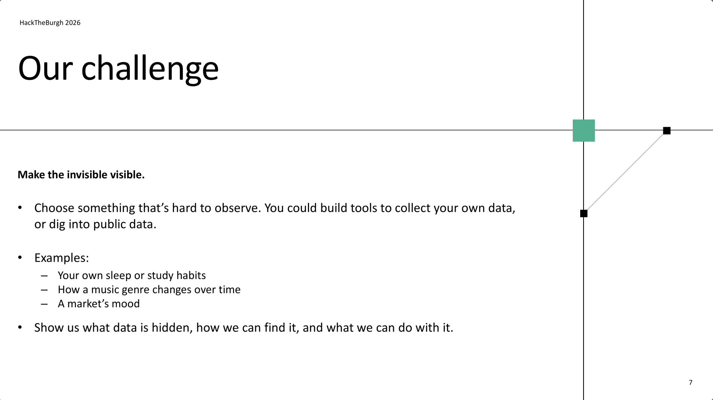
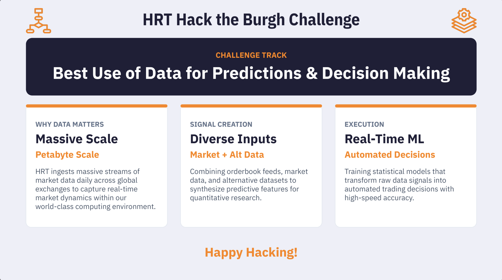

# HackTheBurgh 2026 challenge briefs

We are entering two challenges. The text below is copied from the organisers' slides; the original images are in [img/](img/).

## 1. Main challenge: "Make the invisible visible"

- Choose something that's hard to observe. You could build tools to collect your own data, or dig into public data.
- Examples:
  - Your own sleep or study habits
  - How a music genre changes over time
  - A market's mood
- **Show us what data is hidden, how we can find it, and what we can do with it.**

## 2. HRT sponsor track: Best Use of Data for Predictions & Decision Making

| Pillar | Theme | Brief |
|---|---|---|
| Why data matters | **Massive Scale** (petabyte scale) | HRT ingests massive streams of market data daily across global exchanges to capture real-time market dynamics within our world-class computing environment. |
| Signal creation | **Diverse Inputs** (market + alt data) | Combining orderbook feeds, market data, and alternative datasets to synthesize predictive features for quantitative research. |
| Execution | **Real-Time ML** (automated decisions) | Training statistical models that transform raw data signals into automated trading decisions with high-speed accuracy. |

## How Research Lifecycle Radar answers each brief

**Main challenge: three questions the judges will look for**

| Their question | Our answer |
|---|---|
| What data is hidden? | How fast published trading signals stop working (alpha decay), and which research areas are getting crowded. Neither shows up in one place. |
| How can we find it? | Free public data: paper metadata and citations, factor return series, and live market data. |
| What can we do with it? | Forecast which research areas are rising, flag crowded or decaying signals, and produce a decision briefing. |

**HRT track: what to stress**

- **Diverse inputs:** market data (factor returns) combined with alternative data (papers and the citation network). This is the pillar we fit best, so lead with it.
- **Predictions and decisions:** area forecasts, decay estimates, and backtests should end in a concrete recommendation (`briefing.txt`), not just charts.
- **Scale and real time:** the live layer (`src/live/`) is our answer here. Be honest about its scope in the pitch.
